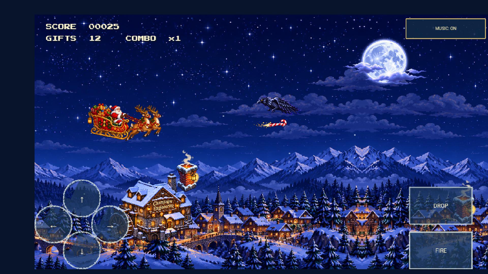
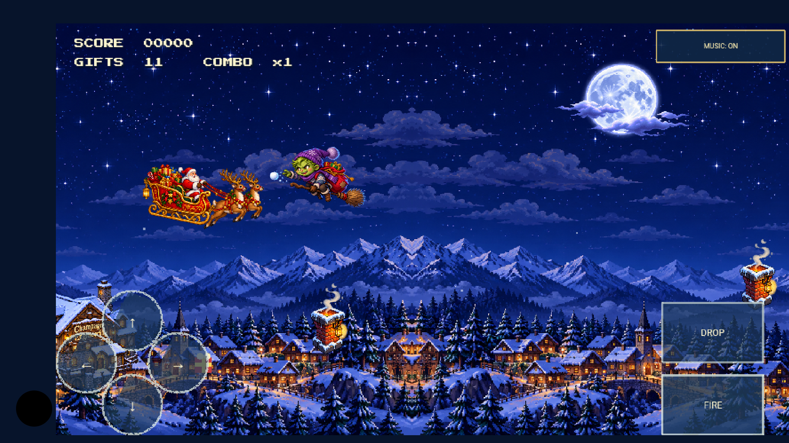
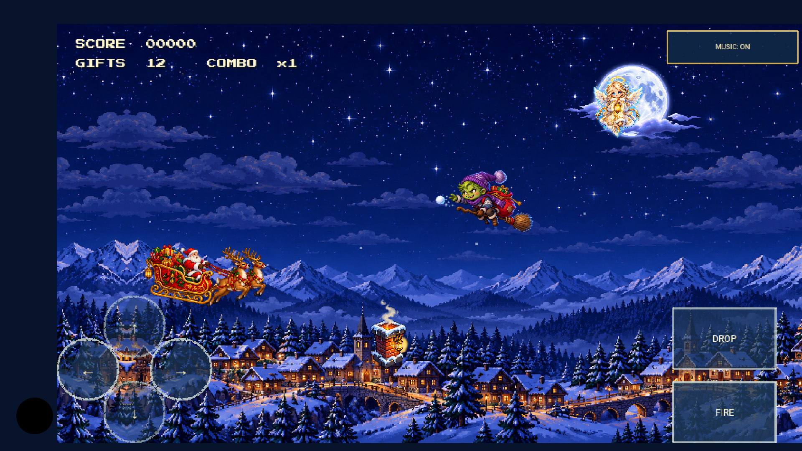
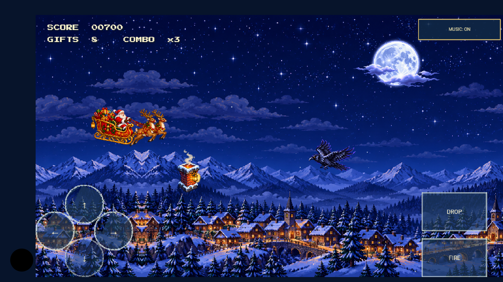

# Sleigh: Chimney Magic

**Status:** 🟢 Production
**Current version:** `2026.10.25-14`

## Google Play

[Get it on Google Play](https://play.google.com/store/apps/details?id=engineering.champagne.sleigh&hl=en-US)

## Overview

Sleigh: Chimney Magic is an arcade-inspired Christmas delivery game for Android. Fly Santa's sleigh over a storybook winter village, line up precise gift drops over glowing chimneys, and protect the run from airborne trouble.

## Features

- One-button present drops with score-building delivery combos
- Animated crows and present-thieves to dodge or clear with candy-cane shots
- Guardian angels that grant a temporary protective shield
- Continuous illustrated winter village scenery with the Champagne Engineering mill
- Arcade-style music and sound effects, with separate on/off controls
- Local top-ten high scores and continuing runs after a completed route
- Keyboard, gamepad, and touch controls for desktop and mobile play
- No account, advertisements, analytics, or online leaderboard

## Screenshots

  
  
  
  

## Repository Purpose

This public repository is maintained for Sleigh: Chimney Magic documentation, release notes, and issue tracking. It does not contain the application source code.

## Documentation

Additional documentation is available in the [docs](docs/) directory.

- [Release Notes](docs/release-notes.md)
- [Product Page](https://champagne.engineering/sleigh)
- [Privacy Policy](https://champagne.engineering/privacy)
- [Terms of Service](https://champagne.engineering/tos)

## Support

Website: https://champagne.engineering

Email: support@champagne.engineering

## Copyright and Disclaimer

© 2026 Champagne Engineering, LLC. All rights reserved.

Unauthorized copying, modification, or redistribution is prohibited. Official distributions are available only through Champagne Engineering-authorized channels.

Sleigh: Chimney Magic is a recreational game. Scores, routes, and results have no cash value and confer no prize, reward, or service entitlement.
