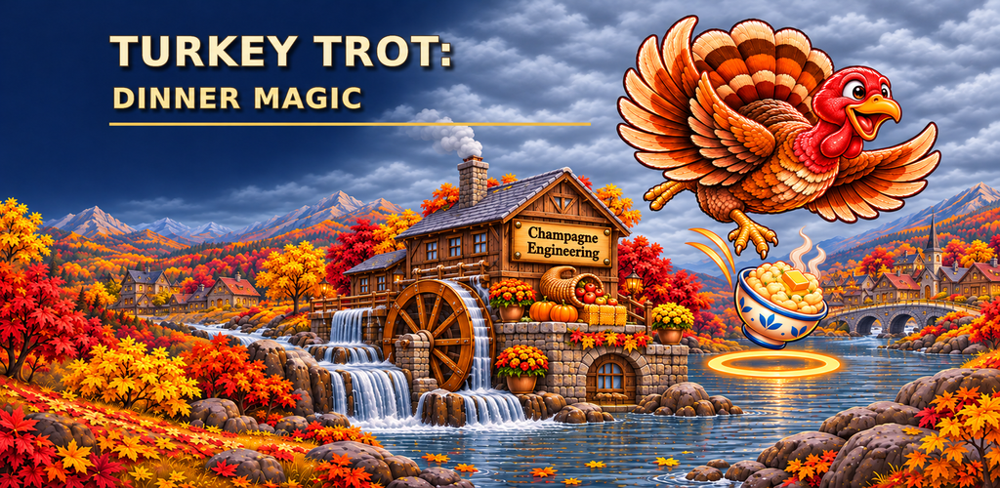
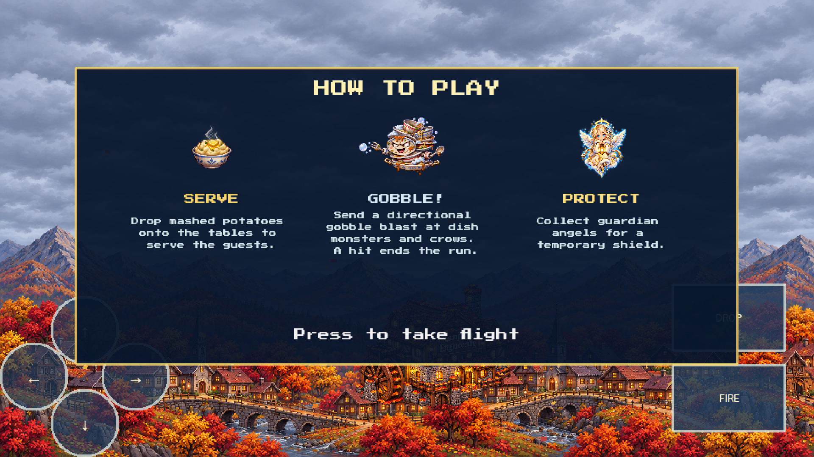
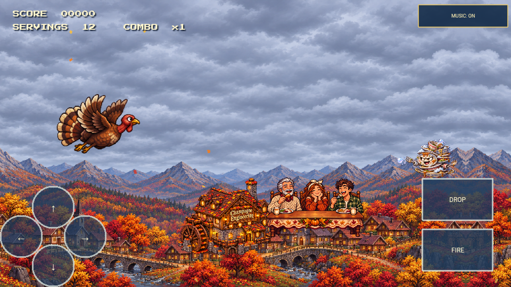
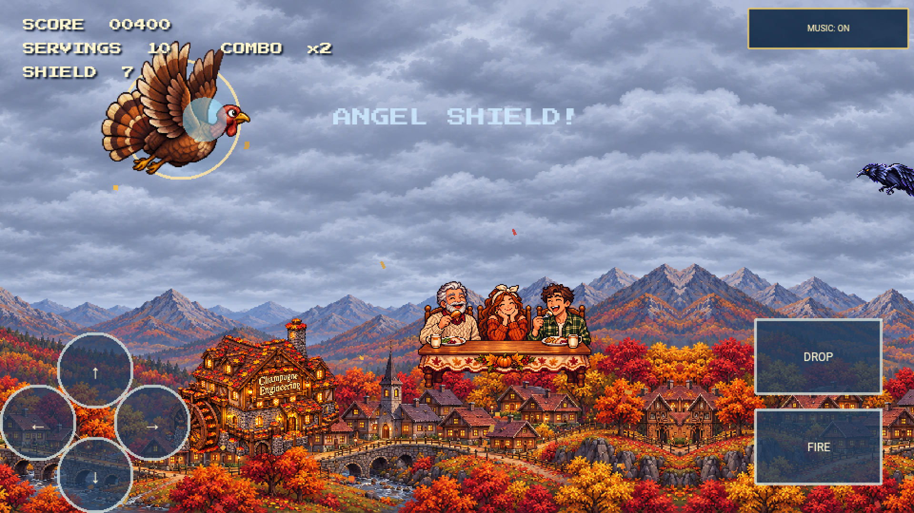
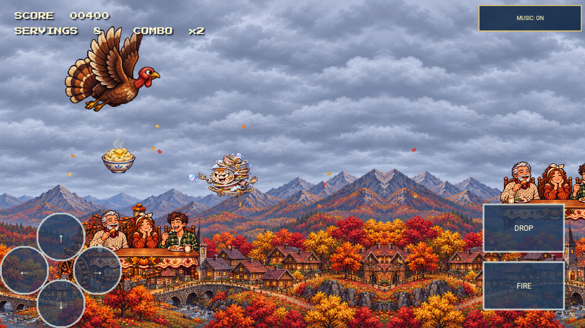

# Turkey Trot: Dinner Magic

**Status:** 🟢 Production
**Current version:** `2026.11.16-3`

## Google Play

[Get it on Google Play](https://play.google.com/store/apps/details?id=engineering.champagne.turkey&hl=en-US)

## Overview

Turkey Trot: Dinner Magic is a Thanksgiving arcade game for Android. Fly a flapping turkey across an autumn village, deliver steaming mashed potatoes to Thanksgiving tables, dodge crows and a monster made of dirty dishes, and keep the run going.

## Features

- Touch controls for flying, firing, and dropping deliveries
- A directional gobble blast to clear hazards
- Guardian angels that grant a temporary protective shield
- Autumn scenery, Thanksgiving guests, mashed-potato deliveries, and a quirky dish monster
- Original arcade-style instrumental music inspired by “America the Beautiful,” plus a turkey gobble sound effect
- Separate music and sound-effect controls
- Local top-ten high scores
- No account, advertisements, analytics, or online leaderboard

## Screenshots

  
  
  
  

## Repository Purpose

This public repository is maintained for Turkey Trot: Dinner Magic documentation, release notes, and issue tracking. It does not contain the application source code.

## Documentation

Additional documentation is available in the [docs](docs/) directory.

- [Release Notes](docs/release-notes.md)
- [Product Page](https://champagne.engineering/turkey)
- [Privacy Policy](https://champagne.engineering/privacy)
- [Terms of Service](https://champagne.engineering/tos)

## Support

Website: https://champagne.engineering

Email: support@champagne.engineering

## Copyright and Disclaimer

© 2026 Champagne Engineering, LLC. All rights reserved.

Unauthorized copying, modification, or redistribution is prohibited. Official distributions are available only through Champagne Engineering-authorized channels.

Turkey Trot: Dinner Magic is a recreational game. Scores, routes, and results have no cash value and confer no prize, reward, or service entitlement.
